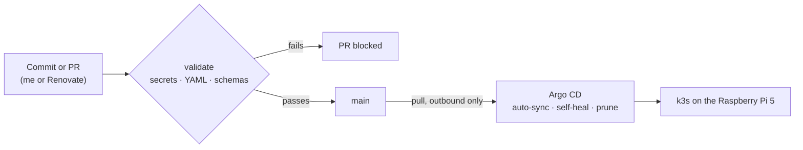
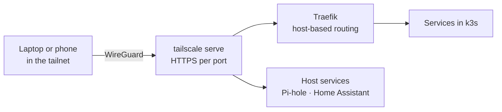

# Luna Sovereign Mesh

[](https://github.com/Guppy997/luna-sovereign-mesh/actions/workflows/validate.yml)
[](LICENSE)

A self-hosted, privacy-first AI infrastructure built on Kubernetes with a strict GitOps-only workflow. All secrets are encrypted before they touch version control: no plaintext credentials, ever.

> **Short on time?** The [incident postmortems](#incident-postmortems) are the most representative part of this repo: nine write-ups of things that actually broke on a single-node cluster, with the numbers and the fixes. Start with [the Argo CD OOM crash loop](docs/incidents/2026-06-12-argocd-oom-crashloop.md) (1,343 OOM kills nobody noticed) or [the thermal cascade](docs/incidents/2026-06-20-thermal-throttle-cascade-crashloop.md) (85.6 °C → every pod loses the API at once). For the design reasoning instead, go to [docs/security.md](docs/security.md).

## Highlights

- **Git is the source of truth.** Argo CD pulls this repo with auto-sync, self-heal and prune, so drift in the cluster is reverted automatically.
- **No plaintext secrets, enforced.** SOPS + age encrypt everything under `secrets/`; CI rejects unencrypted secret files and key or token patterns anywhere else.
- **Every change is schema-checked before it reaches the cluster.** CI validates the app manifests and renders every catalog chart the way Argo CD does, then checks the output with kubeconform, Renovate's auto-merged updates included.
- **Nothing is exposed to the internet.** All access goes through a Tailscale tailnet; no port forwarding, no Funnel.
- **Nine postmortems** of real failures, with root causes, numbers and what changed afterwards.

## Contents

- [What This Project Is](#what-this-project-is)
- [Architecture](#architecture)
- [Incident Postmortems](#incident-postmortems)
- [Security](#security)
- [Toolchain](#toolchain)
- [Repository Layout](#repository-layout)
- [Trade-offs](#trade-offs)
- [Target Hardware](#target-hardware)
- [Status](#status)
- [Running Services](#running-services)
- [How This Was Built](#how-this-was-built)
- [License](#license)

## What This Project Is

Luna Sovereign Mesh is a personal infrastructure project with two goals:

1. **Run a private AI stack** (OpenClaw + custom PWA frontend) on a Raspberry Pi 5 at home, with no data leaving the local network.
2. **Build it the right way:** reproducible, auditable, and secure from day one using the same patterns used in production platform engineering.

The cluster runs on the Pi. The OpenClaw backend runs on a separate Oracle Cloud ARM64 instance, reached from the Pi through the tailnet.

## Architecture

### How a change reaches the cluster



Renovate merges patch updates (and minor updates of a few stateless helper images) on its own once CI passes; everything else waits for a manual merge. On the host, a nightly timer deploys the Docker Compose apps after merges, with a rollback if they do not come up healthy (see [operations notes](docs/operations.md#updates-run-on-their-own)). There is no inbound path into the cluster: Argo CD only pulls from GitHub.

### How a request reaches a service



### Components

```
GitHub (encrypted GitOps repo)
        │ pull (outbound only)
        ▼
   Argo CD (GitOps operator, auto-sync + self-heal)
        │
        ▼
Kubernetes Cluster (k3s, ARM64)
├── Traefik            Ingress, reachable from the tailnet only
├── cert-manager       Certificate management
├── external-secrets   Sync decrypted secrets into the cluster
├── Kyverno            Policy engine + policy reporter
├── Loki               Log aggregation
├── kube-prometheus    Metrics, dashboards & alerting
├── Homepage           Self-hosted service dashboard (entry point)
│
├── Productivity
│   ├── Plane            Project management (Jira alternative)
│   ├── Affine           Knowledge base & docs (Notion alternative)
│   ├── Beaver Habits    Habit tracker
│   ├── Beszel           Lightweight server resource dashboard
│   └── Vaultwarden      Password manager (Bitwarden-compatible)
│
└── AI Stack
    ├── Luna Dashboard   Custom PWA frontend for OpenClaw
    └── OpenClaw         AI assistant backend (Oracle Cloud, via Tailscale)

Host services (outside Kubernetes)
├── Pi-hole + Unbound   Network-wide DNS filtering + recursive resolver
├── Tailscale           Zero-trust mesh VPN: the only way in
└── cron (daily 03:00)   USB backup: DBs, secrets, file uploads
                         (credentials age-encrypted, 14-day retention)

Devices in the tailnet
└── Wall panel        (Galaxy Tab A7 in kiosk mode, tag:wallpanel,
                       direct entry points only)
```

## Incident Postmortems

Things that broke, why they broke, and what changed as a result, written up honestly because a single-node homelab is exactly where you learn this.

| Date | Incident | Impact | What changed |
|---|---|---|---|
| 2026-06-12 | [Argo CD controller OOMKill crash loop](docs/incidents/2026-06-12-argocd-oom-crashloop.md) | 1,343 OOM kills in 8 days, undetected; node froze under memory pressure | Limit sized from observed usage, zram swap, alerts routed to ntfy |
| 2026-06-15 | [Prometheus retention 10d → 7d](docs/incidents/2026-06-15-prometheus-retention-tuning.md) | ~750Mi RSS against an 800Mi limit with no size cap | Proactive 3-line GitOps fix, deployed without downtime |
| 2026-06-16 | [Forced reboot → kubara network crash & silent state corruption](docs/incidents/2026-06-16-forced-reboot-network-recovery.md) | CNI race on restart; DNS integration and Pi-hole blocking silently broken | Post-reboot checklist; automated recovery is a deliberate non-goal on one node |
| 2026-06-20 | [Thermal throttling → K3s API freeze → cascade crash loop](docs/incidents/2026-06-20-thermal-throttle-cascade-crashloop.md) | 85.6 °C SoC, CPU throttled, every pod lost the API at once | Prometheus, Loki and Kyverno disabled until the cooling upgrade |
| 2026-06-29 | [Cooling upgrade + resource optimisation](docs/incidents/2026-06-29-cooling-upgrade-resource-optimisation.md) | Planned change | 3D-printed enclosure + Noctua A6x25: 43.9 °C with all services back; memory requests tuned |
| 2026-07-05 | [Expired GitHub token → Argo CD sync blindness](docs/incidents/2026-07-05-argocd-github-token-expiry.md) | All 17 apps stuck on `Sync: Unknown` behind a generic-looking alert | Token rotated, all apps resynced within 30 s |
| 2026-07-05 | [DNS cascade during AI-HAT driver install](docs/incidents/2026-07-05-dns-cascade-hailo-install.md) | MagicDNS SERVFAIL; containerd, CoreDNS, Argo CD and exit-node clients lost resolution | Tailnet nameservers, Pi-hole-first host DNS, blackbox DNS alerting |
| 2026-10-23 | [Memory pressure alert → Plane process diet](docs/incidents/2026-10-23-memory-pressure-plane-process-diet.md) | `NodeMemoryMajorPagesFaults`, ~1 GiB RAM left; Plane at ~700 MiB, ~40 % of it duplicate Python processes | 1 Uvicorn worker + Celery `solo` pool: Plane ~700 → ~430 MiB; unused images pruned, disk 75 % → 31 % |
| 2026-10-26 | [Reverted Loki upgrade came back + failed swappiness experiment](docs/incidents/2026-10-26-loki-sidecar-reupgrade-swappiness-test.md) | Renovate reopened a reverted chart bump; rules sidecar CrashLoop, `loki-0` 0/2, major faults up to ~9,300/s | Unused rules sidecar disabled; PSI-based `PiMemoryPressure` alert; `swappiness=100` measured worse and rolled back; k3s restarted to evict its Go heap from zram |

Further reading: [docs/security.md](docs/security.md) covers the "why" behind every security decision in detail.

## Security

Secrets are encrypted at rest with [SOPS](https://github.com/getsops/sops) + [Age](https://github.com/FiloSottile/age): no external secret server, ciphertext lives directly in Git. The cluster is unreachable from the internet, and from the local network only DNS and key-only SSH are open; all access to services goes through a [Tailscale](https://tailscale.com) zero-trust tailnet, enforced at both the Kubernetes (`loadBalancerSourceRanges`) and host (UFW default-deny) layers.

Full design rationale (SOPS vs. Vault tradeoffs, zero-trust network enforcement, disaster recovery, backup strategy) → **[docs/security.md](docs/security.md)**

That "no plaintext credentials" claim is enforced, not just stated: [`.github/workflows/validate.yml`](.github/workflows/validate.yml) fails any pull request that adds an unencrypted file under `secrets/`, or that carries a private key or token anywhere else in the tree. The same workflow validates every manifest and every rendered catalog chart against the Kubernetes and CRD schemas. It runs on Renovate's own pull requests too. Those are set to auto-merge patch updates, and Argo CD auto-syncs, so this check is the last place a human decision is encoded before a change reaches the running cluster.

## Toolchain

| Tool | Role | Why this one |
|---|---|---|
| [kubara](https://github.com/kubara-io/kubara) | Cluster scaffolding CLI | Opinionated GitOps-first bootstrap, reduces boilerplate |
| [Argo CD](https://argo-cd.readthedocs.io) | GitOps operator | Industry standard, declarative, Git as single source of truth |
| [SOPS](https://github.com/getsops/sops) | Secret encryption | Native Git integration, no external server needed |
| [Age](https://github.com/FiloSottile/age) | Encryption key provider | Modern, simple, no key server, single private key file |
| [Traefik](https://traefik.io) | Ingress controller | Lightweight, ARM-friendly, host-based routing |
| [Kyverno](https://kyverno.io) | Policy engine | Kubernetes-native, no sidecar proxies, YAML-based policies |
| [k3s](https://k3s.io) | Kubernetes distribution | Minimal footprint, built for ARM and edge devices |
| [Tailscale](https://tailscale.com) | Zero-trust network access | WireGuard mesh, ACLs, MagicDNS, no exposed ports |
| [Pi-hole](https://pi-hole.net) + [Unbound](https://nlnetlabs.nl/projects/unbound/) | DNS layer | Ad blocking + fully recursive resolution, no third-party DNS |
| [Renovate](https://docs.renovatebot.com) | Dependency updates | Charts, images and actions; patch updates auto-merge behind CI |
| [kubeconform](https://github.com/yannh/kubeconform) | Schema validation in CI | Fast and strict, CRD schemas via the datreeio catalog |

## Repository Layout

```
luna-sovereign-mesh/
├── .github/workflows/validate.yml   # PR checks: encrypted secrets, YAML, schemas
├── .sops.yaml                       # Encryption rules: which files, which key
├── config.yaml                      # kubara cluster configuration
├── renovate.json                    # Dependency updates, patch auto-merge
├── CHANGELOG.md                     # Notable changes (Keep a Changelog)
├── clusters/dev/
│   ├── apps/                        # Argo CD Applications + plain manifests per app
│   └── secrets/                     # SOPS-encrypted Kubernetes secrets
├── customer-service-catalog/helm/   # Values for the platform services, tuned for this cluster
├── managed-service-catalog/helm/    # Wrapper chart per platform service (generated by kubara)
├── bootstrap.sh                     # Rebuild host + cluster on a fresh Pi (idempotent)
├── restore.sh                       # Put the data back from the USB backup stick
├── host/                            # Host configuration: packages, DNS, UFW, cron, backup, host apps
├── docs/
│   ├── disaster-recovery.md         # From an empty SD card to everything running
│   ├── security.md                  # Security design, disaster recovery, backups
│   ├── operations.md                # Non-obvious operational behaviour
│   ├── wallpanel.md                 # Wall panel: threat model, ports, provisioning
│   └── incidents/                   # Postmortems
└── scripts/                         # tailscale serve port map, SOPS helpers
    └── wallpanel/                   # Tablet provisioning (packages, FreeKiosk)
```

**Written for this cluster:** the ten applications under `clusters/dev/apps/` (manifests, ingress routes, external secrets, alert rules, the daily health digest), the values in `customer-service-catalog/`, CI, Renovate config, scripts and all documentation.

**Generated by kubara, then adapted:** the wrapper charts in `managed-service-catalog/` and the shape of `config.yaml`. Changes there are chart upgrades and Pi-specific tuning: memory limits, slower reconcile and scrape intervals, components switched off that a single-user cluster does not need.

## Trade-offs

Deliberate decisions that would look different on a multi-node production platform:

- **Single node, no high availability.** One Raspberry Pi runs everything. Failure modes are documented in the postmortems rather than engineered away; a second node would cost more than the downtime it prevents.
- **`clusters/dev` is the production cluster.** `dev` is the stage name from the kubara scaffold, and there is only one cluster. Renaming the path would mean re-creating every Argo CD Application for no functional gain.
- **Some image tags are mutable.** Plane's backend runs on `stable`, and Renovate skips Plane images because the versioned ones introduced incompatible changes (see `renovate.json`). `redis:8-alpine`, `postgres:18-alpine`, `pgvector/pgvector:pg18`, `node:24-alpine` and `busybox:1.38` are pinned to a major or minor version only. Everything else is pinned to a version or digest.
- **Two images are built on the Pi.** `luna-pwa` and `luna-adapter` use `imagePullPolicy: Never`. There is no registry, so Renovate cannot track them.
- **The `tailscale serve` port map lives outside GitOps.** It is host state in tailscaled; [`scripts/apply-tailscale-serve.sh`](scripts/apply-tailscale-serve.sh) is the source of truth and restores it.
- **Traefik routes by header, not by port.** The Traefik `tailscale serve` ports pick the app from `X-Forwarded-Host`, which `tailscale serve` builds from the client's `Host` header. A client that may reach one Traefik port can therefore reach every Traefik app. Personal devices may reach every port anyway; restricted clients such as the wall panel get direct ports to a pinned ClusterIP instead. One Traefik entrypoint per port would close this properly.
- **Auto-merge plus auto-sync.** Renovate patch updates merge without a human, and Argo CD applies them right away. CI is the only gate in between, which is why it validates schemas and not just syntax.
- **Backups live on a single medium.** Daily backups go to a USB drive (credentials age-encrypted); an off-site copy is next on the list.

## Target Hardware

| Environment | Hardware | Purpose |
|---|---|---|
| Cluster | Raspberry Pi 5 (8GB) | k3s node: GitOps platform, AI frontend, self-hosted services |
| AI backend | Oracle Cloud VM (ARM64, free tier) | OpenClaw, reached from the Pi through Tailscale |

## Status

In active use since June 2026 on a single node. The core platform (GitOps, zero-trust networking, secrets, monitoring) is done, and the AI stack and productivity apps run daily.

**Latest milestones:**

- **Wall panel**: an old Galaxy Tab A7 (Android 12, no updates since June 2024) shows Homepage and Home Assistant in kiosk mode and is treated as untrusted. Its Tailscale tag reaches seven direct entry points and nothing else, and nothing can reach the tablet. Building it turned up that every Traefik port can be bypassed with a forged `Host` header, so restricted clients never get one. Details in [docs/wallpanel.md](docs/wallpanel.md).
- **Plane process diet:** a memory-pressure alert led to `ps` inside the pods instead of just `kubectl top`: ~40 % of Plane's ~700 MiB was duplicate Python workers. One Uvicorn worker and a Celery `solo` pool cut Plane to ~430 MiB with no loss of function, and pruning 180 unreferenced images took the disk from 75 % to 31 %.
- **Monitoring gap closed:** node-exporter was deployed but never scraped, so 26 host-level alert rules (CPU, RAM, disk, temperature) had been silently evaluating against no data. Found by auditing alert rules against live targets rather than trusting a green dashboard.
- **Backup consolidation:** three overlapping backup paths merged into one script; credentials encrypted with age before they touch the USB medium; **restore verified end-to-end** for the first time, not just assumed.
- **Housekeeping:** journald capped (was unbounded at 10% of disk), unattended-upgrade reports moved from a non-existent MTA to ntfy, a failing `unbound-resolvconf` unit retired.

**Up next:** off-site copy of the encrypted backup set (currently single-medium), re-raise Prometheus retention now that thermal headroom exists, move the Kyverno exclusions to CEL policies, give Traefik one entrypoint per port instead of header matching, print a wall mount for the panel, find a new image source or replacement for MinIO (see [docs/operations.md](docs/operations.md)).

## Running Services

All services are reachable exclusively from inside the tailnet, routed by Traefik via host-based rules on the node's MagicDNS name.

<details>
<summary>Port map (14 ports, 17 services)</summary>

| Service | Port | Notes |
|---|---|---|
| Lern-PWA | `https://…:10000` | Learning tracker, runs on the host (port 8090) |
| Homepage | `https://…:10001` (root) | Dashboard & entry point for all services |
| ArgoCD | `…:10001/argocd` | GitOps operator |
| Pi-hole | `https://…:10002/admin` | DNS + ad blocking, runs on the host |
| ntfy | `https://…:10003` | Self-hosted push notifications, fed by Alertmanager |
| Luna Dashboard | `https://…:10004` | AI assistant frontend (OpenClaw PWA) |
| Plane | `https://…:10005` | Project management (Jira alternative) |
| Vaultwarden | `https://…:10006` | Password manager (Bitwarden-compatible) |
| Affine | `https://…:10007` | Knowledge base & docs (Notion alternative) |
| Beszel | `https://…:10008` | Lightweight server resource monitoring |
| Beaver Habits | `https://…:10009` | Habit tracker |
| Grafana | `…:10001/grafana` | Monitoring dashboards |
| Prometheus | `…:10001/prometheus` | Metrics & alerting |
| Home Assistant | `https://…:10010` | Smart home, runs on the host (port 8123) |
| Fitness-PWA | `https://…:10011` | Gym tracker, runs on the host (port 8091) |
| Homepage (wall panel) | `https://…:10012` | Homepage only, bypassing Traefik, for the wall tablet (`tag:wallpanel`), see [docs/wallpanel.md](docs/wallpanel.md) |
| Beszel (direct) | `https://…:10013` | Beszel only, bypassing Traefik; reachable from the wall tablet |

</details>

The `tailscale serve` port map is not GitOps-managed. After a state loss, restore it with [`scripts/apply-tailscale-serve.sh`](scripts/apply-tailscale-serve.sh) (source of truth for the mapping).

## How This Was Built

Built with AI assistance (Claude). Idea, architecture, requirements, testing and operations are mine; every change is reviewed and versioned.

Security issues: please report them privately, see [SECURITY.md](SECURITY.md).

**Repository history:** On 2026-10-24 the history was moved to a fresh repository to remove a private email address from the commit metadata. Commits, dates and contents are unchanged. Pull request numbers in older commit messages refer to the archived, private repository.

## License

[Apache License 2.0](LICENSE). The repository was bootstrapped with [kubara](https://github.com/kubara-io/kubara) (also Apache-2.0); see [NOTICE](NOTICE) for attribution.
